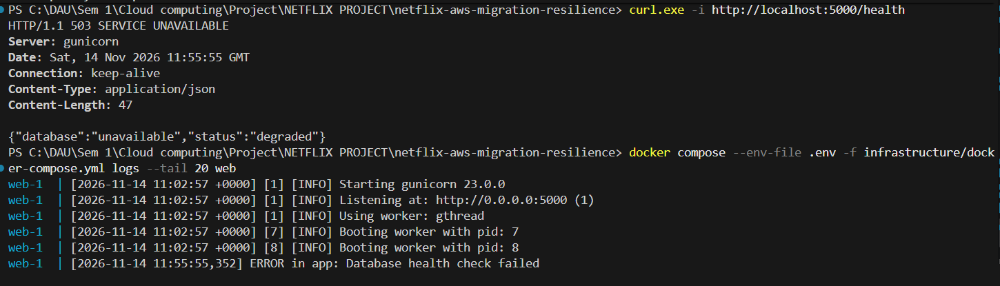
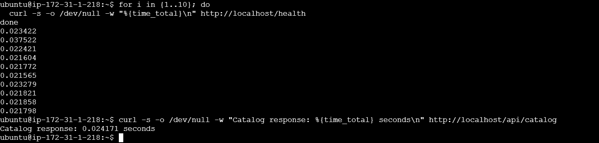
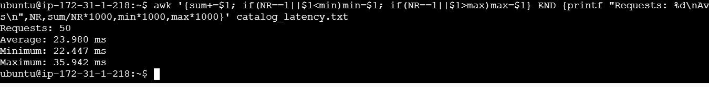
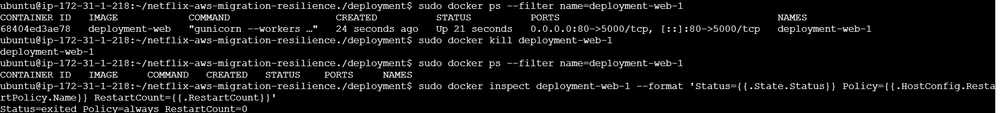
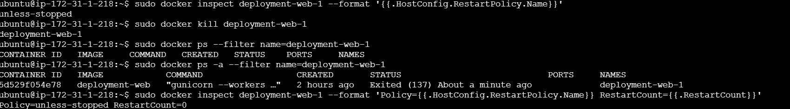

# StreamFlix – Resilience and Performance Experiment Results

**Test date:** 14 November 2026  
**Application:** StreamFlix / Netflix Demo  
**AWS region:** `ap-south-1` (Mumbai)  
**Deployment target:** EC2 web container connected to Amazon RDS for PostgreSQL  
**Database:** Existing RDS instance (`streamdb`)  

## 1. Summary of observed results

| Experiment | Failure injected / action | Expected behavior | Observed behavior | Outcome |
|---|---|---|---|---|
| EC2 web-container restart | Ran `sudo docker restart deployment-web-1` | Web container restarts and reconnects to RDS | Container restarted; `/health` returned `status: ok` and `database: connected` | Passed: restart and database connectivity verified |
| Local database outage | Stopped the local Compose `db` service while the web service remained running | Application reports database unavailability without crashing | `/health` returned HTTP 503 with `database: unavailable` and `status: degraded`; application logs showed a database connection error | Passed: failure detected and degraded health reported |
| Local database restoration | Started the local Compose `db` service again | Application reconnects after the database becomes available | Database container became healthy; without restarting the web service, `/health` returned HTTP 200 with `database: connected` and `status: ok` | Passed: application recovered its database connection |
| EC2 forced web-container termination — first test | Ran `sudo docker kill deployment-web-1` while the policy was `unless-stopped` | Docker automatically restarts the web container | Container exited with code 137 and did not appear in `docker ps`; it required `sudo docker start deployment-web-1` | Not passed: automatic restart was not observed |
| EC2 forced web-container termination — second test | Changed the container policy to `always`, then repeated `docker kill` | Docker automatically restarts the web container | Container again exited with code 137; `docker inspect` showed `Status=exited`, `Policy=always`, `RestartCount=0`. It required a manual start | Not passed: automatic restart was still not observed |

## 2. Recovery and health observations

### Local database outage and recovery

- With the local PostgreSQL service stopped, the web application remained available to report degraded health.
- Health response during the outage: HTTP `503`, `{"database":"unavailable","status":"degraded"}`.
- After the local database service was started and became healthy, the existing web process reconnected.
- Health response after restoration: HTTP `200`, `{"application":"Netflix Demo","database":"connected","status":"ok"}`.
- A recovery polling run reported approximately **0.25 seconds** to observe the healthy response after the database had already been restored. This is the post-restoration health-detection interval, **not** the total outage duration or database recovery time.

### EC2 web-container restart and forced termination

- A normal Docker restart (`docker restart`) completed, and the health endpoint subsequently confirmed RDS connectivity.
- A forced termination (`docker kill`, signal 9) produced exit code `137`.
- The first forced-termination test used `unless-stopped`; the second used `always`.
- The `always` policy was set on the existing container and also made persistent in `deployment/docker-compose.rds.yml` under the `web` service. `docker compose config` confirmed `restart: always` for `web` (the one-shot migration service remained `restart: "no"`).
- Despite this configuration, the repeated forced-termination test did not show an automatic restart. Docker inspection reported `RestartCount=0` and `Status=exited`.
- The web container was manually started after each failed recovery test. The health endpoint then returned `database: connected` and `status: ok`.
- The reason Docker did not restart the container was **not established** by the collected evidence. Docker events confirmed the kill event with signal 9 and the subsequent `die` event with exit code 137, but did not establish the cause of the missing restart.

## 3. EC2 localhost performance observations

These timings were measured from the EC2 instance against `localhost`; they are not measurements of public internet or end-user latency.

| Request | Sample count | Average | Minimum | Maximum |
|---|---:|---:|---:|---:|
| `/health` | 10 | 23.706 ms | 21.565 ms | 37.522 ms |
| `/api/catalog` | 50 | 23.980 ms | 22.447 ms | 35.942 ms |

## 4. Conclusions

1. The application detects loss of its local database dependency and reports a degraded health state rather than reporting healthy status.
2. After the local database service is restored, the running application can reconnect without requiring a web-container restart.
3. The EC2 application successfully restarted through a normal Docker restart and subsequently re-established its connection to RDS.
4. The forced-termination tests did **not** demonstrate automatic container recovery, even after the restart policy was changed to `always` and the Compose configuration was updated. Automatic self-healing must therefore be recorded as **not demonstrated** in this experiment.
5. The observed results support basic health detection and database reconnection, but do not demonstrate uninterrupted service during a web-container failure. Redundant application instances and a load balancer would be needed to investigate higher-availability behavior.

## 5. Evidence to attach

